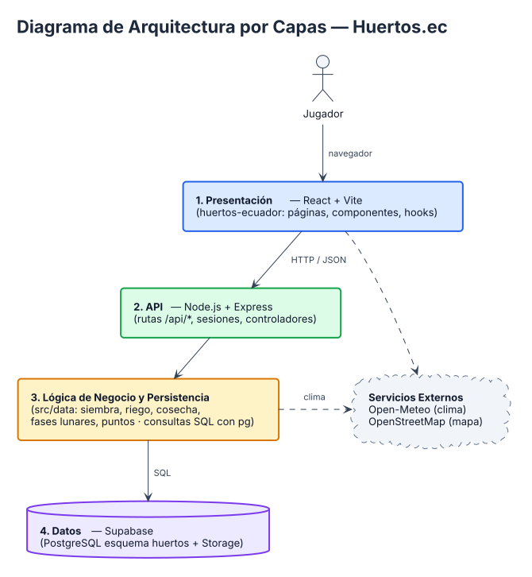
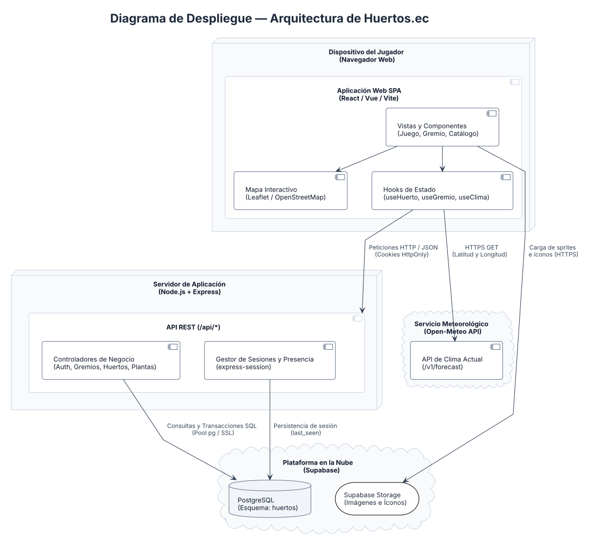
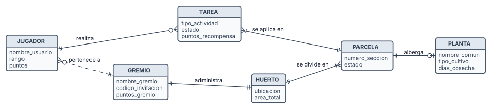

# Arquitectura y Diseño del Producto

El sistema **Huertos.ec** utiliza una arquitectura Cliente-Servidor dividida en tres partes principales: el frontend web en React, el servidor backend en Node.js con Express y la base de datos en la nube con Supabase.

---

## 1. Partes del Sistema

1. **Frontend (`huertos-ecuador/`):** Aplicación web desarrollada con **React** y **Vite** que se ejecuta en el navegador del jugador. Provee las pantallas del juego, el mapa interactivo del Ecuador con **Leaflet**, el catálogo de plantas ecuatorianas y los paneles de control del gremio.
2. **Backend (`backend/`):** Servidor desarrollado con **Node.js** y **Express** que expone las rutas de la API (`/api/*`). Valida las sesiones de los usuarios, ejecuta las reglas de negocio para sembrar, regar y cosechar, calcula las fases lunares y gestiona los permisos por rol.
3. **Base de Datos y Servicios Externos:**
   - **Supabase (PostgreSQL y Storage):** Gestiona los datos estructurados del sistema (usuarios, gremios, huertos, parcelas, plantas y tareas) y almacena las imágenes de catálogo e íconos.
   - **Open-Meteo API:** Servicio meteorológico externo que provee la temperatura y condiciones climáticas en tiempo real según la ubicación geográfica del huerto.

---

## 2. Diagrama de Arquitectura por Capas



Huertos.ec sigue una arquitectura por capas. El jugador interactúa con la **capa de presentación** (React + Vite), que se comunica por HTTP/JSON con la **capa de API** (Node.js + Express), responsable de gestionar el enrutamiento, las sesiones y los controladores de negocio. La **capa de lógica de negocio y persistencia** aplica las reglas de cultivo (siembra, riego, cosecha, fases lunares y asignación de puntos) e interactúa con la **capa de datos** en Supabase (PostgreSQL y Storage). Open-Meteo provee datos meteorológicos y OpenStreetMap la cartografía interactiva.

---

## 3. Diagrama de Despliegue



| Componente | Función principal |
| :--- | :--- |
| **Navegador Web (Frontend)** | Muestra las pantallas, el mapa y el huerto interactivo, y se comunica con el backend mediante peticiones HTTP en formato JSON. |
| **Servidor Node.js + Express** | Recibe las peticiones del frontend, valida la sesión del usuario y ejecuta las consultas y reglas de negocio. |
| **Supabase (PostgreSQL + Storage)** | Almacena toda la información del sistema y sirve los recursos multimedia e imágenes de plantas. |
| **Open-Meteo API** | Provee la temperatura y el estado del clima según la latitud y longitud del gremio. |

---

## 4. Modelo Conceptual de Dominio (Entidades Principales)

Para facilitar la comprensión del sistema a nivel de cliente y negocio, la información se organiza alrededor de seis conceptos principales que representan directamente el funcionamiento del huerto comunitario y sus dinámicas:



### Descripción de Entidades y Flujos del Modelo
- **JUGADOR:** Cuenta del participante donde se registra su identidad (`nombre_usuario`), su progreso de juego (`rango`) y su experiencia acumulada (`puntos`).
- **GREMIO:** Comunidad u organización barrial que gestiona un espacio común. Dispone de un `codigo_invitacion` de 6 dígitos para incorporar nuevos miembros y acumula `puntos_gremio` para el ranking nacional.
- **HUERTO:** El espacio físico administrado por el gremio, geolocalizado en el mapa del Ecuador (`ubicacion`) con sus dimensiones (`area_total`).
- **PARCELA:** Subdivisión funcional del huerto identificada por su `numero_seccion` y su `estado` operativo (libre, en cultivo o lista para cosecha).
- **PLANTA:** Especie vegetal del catálogo ecuatoriano (`nombre_comun`, `tipo_cultivo` y `dias_cosecha`).
- **TAREA:** Acción o cuidado agronómico (`tipo_actividad`: siembra, riego, abono, cosecha) que el jugador ejecuta sobre una parcela. Al completarse, otorga `puntos_recompensa` que benefician tanto al jugador como al gremio.

---

## 5. Rangos y Puntajes del Juego

El sistema implementa un esquema de gamificación diseñado para incentivar el aprendizaje continuo y la participación comunitaria activa en las labores del huerto.

### 5.1. Rangos del Jugador

| Rango | Puntos Requeridos | Privilegios y Rol en el Gremio |
| :--- | :---: | :--- |
| **Novato** | 0 - 50 | Rango inicial asignado al registrarse. Participa en tareas básicas individuales del huerto. |
| **Aprendiz** | 51 - 120 | Participante activo que colabora con constancia en riegos, siembras y cosechas. |
| **Oficial** | 121 - 250 | Miembro con liderazgo comunitario; cuenta con permisos para editar la descripción y publicar anuncios en el gremio. |
| **Maestro** | Más de 250 | Máximo reconocimiento dentro de la comunidad; coordina actividades grupales, edita avisos y lidera el huerto. |

### 5.2. Actividades y Puntos Otorgados

| Actividad del Huerto | Modalidad | Puntos Otorgados |
| :--- | :---: | :---: |
| **Retiro de maleza** | Individual | 15 puntos |
| **Preparación de tierra** | Grupal | 30 puntos por inscrito |
| **Siembra en parcela** | Individual | 30 puntos |
| **Colocación de señalética** | Individual | 25 puntos |
| **Riego de parcela** | Individual | 5 puntos |
| **Aplicación de abono orgánico** | Grupal | 20 puntos |
| **Limpieza integral del huerto** | Grupal | 30 puntos por inscrito |
| **Ritual ancestral de agradecimiento** | Grupal (opcional) | 20 puntos por inscrito |
| **Cosecha de cultivo maduro** | Individual | 35 puntos |
| **Secado y almacenamiento** | Individual o Grupal | 20 puntos |

---

## 6. Especificaciones Técnicas de Implementación

A continuación se presentan los detalles técnicos de desarrollo, estructura de archivos, rutas de API y mecanismos de seguridad de la solución.

??? note "Detalle Técnico: Estructura de Carpetas del Proyecto"

    ```text
    GR2_Calidad_Proyecto/
    ├── huertos-ecuador/          # Frontend (React + Vite)
    │   ├── public/               # Recursos estáticos, imágenes de huertos y plantas
    │   ├── src/
    │   │   ├── components/       # Componentes modales, parcelas, tarjetas y paneles
    │   │   ├── data/             # Definiciones estáticas de fases lunares y herramientas
    │   │   ├── hooks/            # Hooks reactivos (useHuerto, useGremio, useClima, useTareas)
    │   │   ├── pages/            # Vistas principales (Login, Registro, Juego, Gremio, Catálogo)
    │   │   └── services/         # Clientes de comunicación HTTP hacia la API
    │   └── test/                 # Suite de pruebas automatizadas del frontend
    │
    └── backend/                  # Backend (Node.js + Express)
        ├── migrations/           # Scripts SQL y esquemas de base de datos
        ├── scripts/              # Utilidades de mantenimiento y carga de imágenes
        ├── src/
        │   ├── config/           # Clientes de base de datos (pg Pool) y sesiones
        │   ├── controllers/      # Controladores de dominio (Auth, Gremios, Huertos, Plantas)
        │   ├── data/             # Reglas agronómicas, cálculo astronómico y baremos de puntos
        │   └── routes/           # Declaración de endpoints REST (/api/*)
        └── test/                 # Pruebas unitarias y de integración del backend
    ```

??? note "Detalle Técnico: Rutas Principales de la API REST"

    | Módulo | Método | Ruta | Propósito |
    | :--- | :---: | :--- | :--- |
    | **Autenticación** | `POST` | `/api/auth/registro` | Registra una cuenta nueva con rango inicial Novato y 0 puntos. |
    | | `POST` | `/api/auth/login` | Autentica credenciales y emite la cookie de sesión protegida. |
    | | `POST` | `/api/auth/presence` | Actualiza la marca de tiempo de actividad en línea del usuario. |
    | | `POST` | `/api/auth/logout` | Invalida la sesión activa del jugador. |
    | **Gremios** | `GET` | `/api/gremios` | Lista las comunidades ordenadas por puntuación para el ranking. |
    | | `GET` | `/api/gremios/:id` | Retorna el detalle del gremio, sus integrantes y huerto asignado. |
    | | `POST` | `/api/gremios` | Crea un nuevo gremio con su geolocalización y código de 6 dígitos. |
    | | `PATCH` | `/api/gremios/:id/perfil` | Permite a Oficiales y Maestros modificar descripción y anuncios. |
    | | `POST` | `/api/gremios/unirse` | Incorpora al jugador a una comunidad mediante código o QR. |
    | **Plantas** | `GET` | `/api/plantas` | Retorna el catálogo oficial de especies nativas y requerimientos. |
    | **Huertos y Tareas** | `GET` | `/api/huertos/:id` | Consulta la grilla de parcelas y el estado de cultivos sembrados. |
    | | `GET` | `/api/recordatorios/huerto/:huertoId/panel` | Obtiene recordatorios pendientes y condiciones climáticas/lunares. |
    | | `POST` | `/api/recordatorios/huerto/:huertoId/siembras` | Asigna un cultivo a una parcela libre (+30 puntos). |
    | | `POST` | `/api/recordatorios/huerto/:huertoId/riegos` | Registra el riego de una sección (+5 puntos). |
    | | `POST` | `/api/recordatorios/huerto/:huertoId/tareas/:tareaId/completar` | Valida una labor o cosecha completada y transfiere los puntos. |
    | **Perfil** | `GET` | `/api/perfil/:id` | Consulta información personal, rango y habilidades comunitarias. |
    | | `PUT` | `/api/perfil/:id/descripcion` | Actualiza la descripción de experiencia del jugador. |

??? note "Detalle Técnico: Seguridad e Integridad de Datos"

    - **Seguridad en Autenticación y Autorización:**
      - Las contraseñas se almacenan mediante hashing criptográfico robusto (`bcrypt`).
      - La sesión se mantiene en el servidor mediante cookies firmadas con atributos `HttpOnly`, `SameSite` y `Secure`.
      - Se implementa verificación de control de acceso basada en roles (RBAC) previo a cualquier operación administrativa en el gremio.
    - **Integridad Transaccional de Datos:**
      - El otorgamiento de puntos y la sincronización con el puntaje acumulado del gremio se ejecutan en transacciones atómicas dentro de PostgreSQL, previniendo duplicidad de recompensas o desincronización en el ranking nacional.
