# Casos de Prueba con Resultados

Registro completo de los **10 casos de prueba** ejecutados sobre la versión 1 de **Huertos.ec** (`P-001` a `P-010`), correspondientes a las historias de usuario `HU-001` a `HU-010`. Todos los casos fueron ejecutados y **aprobados** con sus respectivas evidencias.

## Resumen de Ejecución

| ID | Caso de Prueba | Historia | Responsable | Fecha | Estado |
| :--- | :--- | :--- | :--- | :--- | :--- |
| **P-001** | Registro e inicio de sesión del jugador | HU-001 | Emilio Camino | 11-noviembre-2026 | Aprobado |
| **P-002** | Creación y ubicación real del gremio | HU-002 | Emilio Camino | 11-noviembre-2026 | Aprobado |
| **P-003** | Unirse a un gremio mediante código o código QR | HU-003 | Karen Mosquera | 11-noviembre-2026 | Aprobado |
| **P-004** | Consulta y filtrado del catálogo de plantas ecuatorianas | HU-004 | Karen Mosquera | 11-noviembre-2026 | Aprobado |
| **P-005** | Siembra por parcelas y visualización del crecimiento en el huerto | HU-005 | Oscar Tamayo | 12-noviembre-2026 | Aprobado |
| **P-006** | Consulta del clima actual y la fase lunar en el huerto | HU-006 | Oscar Tamayo | 12-noviembre-2026 | Aprobado |
| **P-007** | Completar recordatorios, cosechar plantas y sumar puntos | HU-007 | Jorge Oviedo | 11-noviembre-2026 | Aprobado |
| **P-008** | Ver perfil del jugador y editar descripción de habilidades | HU-008 | Velky Jibaja | 11-noviembre-2026 | Aprobado |
| **P-009** | Ver miembros en línea y consultar el ranking de gremios | HU-009 | Velky Jibaja | 11-noviembre-2026 | Aprobado |
| **P-010** | Edición de la descripción y anuncios del gremio por Oficiales y Maestros | HU-010 | Mateo Aguirre | 11-noviembre-2026 | Aprobado |

---

## P-001: Registro e inicio de sesión del jugador (HU-001)

<table class="hu-table">
  <tbody>
    <tr>
      <td class="hu-col-nro">
        
<strong>ID:</strong> P-001

      </td>
      <td class="hu-col-titulo">
        
<strong>Título: Registro e inicio de sesión del jugador (HU-001)</strong>

      </td>
      <td class="hu-col-meta">
        
<strong>Fecha:</strong> 11-noviembre-2026

        
<strong>Responsable:</strong> Emilio Camino

      </td>
    </tr>
    <tr>
      <td colspan="3">
        
<strong>Descripción:</strong>

        
Validar el registro de nuevos jugadores y el inicio de sesión en la aplicación, comprobando la respuesta a un inicio de sesión erróneo, las verificaciones al registrarse, y la redirección tras iniciar sesión.

      </td>
    </tr>
    <tr>
      <td colspan="3">
        
<strong>Procedimiento de prueba:</strong>

        <ol>
          <li>Abrir la aplicación en el portal de inicio de sesión.</li>
          <li>Ingresar el usuario <code>"juan_suarez"</code> y una contraseña incorrecta (<code>"00000000"</code>), y dar clic en <strong>"Iniciar sesión"</strong>.</li>
          <li>Hacer clic en <strong>"Registrarse"</strong> para navegar a <code>/registro</code>, llenar los campos obligatorios usando el usuario existente <code>"juan_suarez"</code> y una contraseña corta (<code>"123"</code>), aceptar términos y dar clic en <strong>"Crear mi cuenta"</strong>.</li>
          <li>Actualizar la contraseña a <code>"12345678"</code> manteniendo el usuario <code>"juan_suarez"</code> y dar clic en <strong>"Crear mi cuenta"</strong>.</li>
          <li>Cambiar el nombre de usuario a <code>"qa_huertos_1111"</code> con contraseña <code>"12345678"</code> y dar clic en <strong>"Crear mi cuenta"</strong>.</li>
          <li>En el modal de confirmación, dar clic en <strong>"COMENZAR"</strong> para regresar al login.</li>
          <li>Iniciar sesión con la contraseña correcta de <code>"juan_suarez"</code>, <code>"12345678"</code>.</li>
        </ol>
      </td>
    </tr>
    <tr>
      <td colspan="3">
        
<strong>Resultados esperados:</strong>

        <ul>
          <li><strong>Paso 2:</strong> El sistema muestra <code>"Usuario o contraseña incorrectos."</code>.</li>
          <li><strong>Paso 3:</strong> La validación impide el registro indicando <code>"mínimo 8 caracteres"</code>.</li>
          <li><strong>Paso 4:</strong> El servidor no permite usuarios repetidos y muestra <code>"El nombre de usuario ya existe."</code>.</li>
          <li><strong>Paso 5:</strong> Se registra la cuenta con 0 puntos, notificando el registro de la cuenta.</li>
          <li><strong>Paso 6:</strong> El usuario nuevo sin gremio inicia sesión y es redirigido a <code>/seleccion-gremio</code>.</li>
          <li><strong>Paso 7:</strong> El usuario <code>"juan_suarez"</code> (con gremio asignado) inicia sesión y es redirigido directamente a <code>/juego</code> mostrando su perfil y puntos.</li>
        </ul>
      </td>
    </tr>
    <tr>
      <td colspan="2">
        
<strong>Resultados obtenidos:</strong>

        <ul>
          <li>El login inválido mostró <code>"Usuario o contraseña incorrectos."</code>.</li>
          <li>Las restricciones por el tamaño mínimo de contraseña y el usuario duplicado sí fueron notificados.</li>
          <li>El registro con <code>"qa_huertos_1111"</code> fue válido.</li>
          <li>El login correcto de <code>"juan_suarez"</code> redirigió al panel de juego.</li>
        </ul>
      </td>
      <td>
        
<strong>Estado de Ejecución:</strong>

        
Reprobado ( &nbsp; )

        
<strong>Aprobado ( X )</strong>

      </td>
    </tr>
  </tbody>
</table>

**Capturas:**

1. **Login fallido con contraseña incorrecta:**
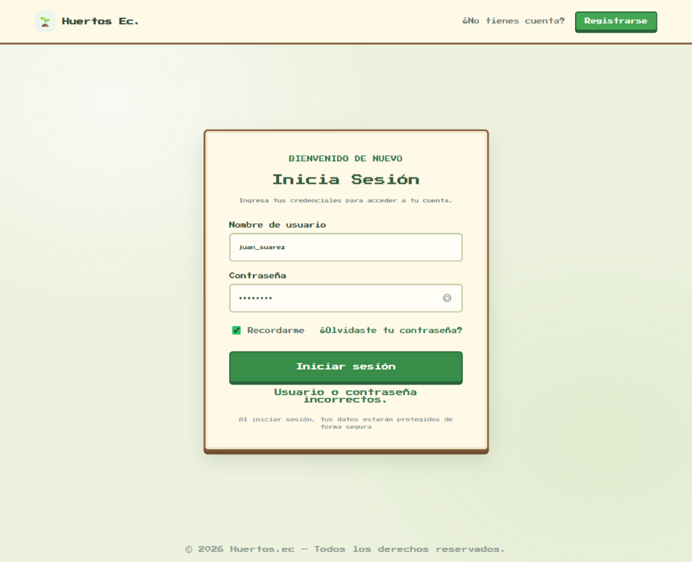

2. **Validación de usuario duplicado:**
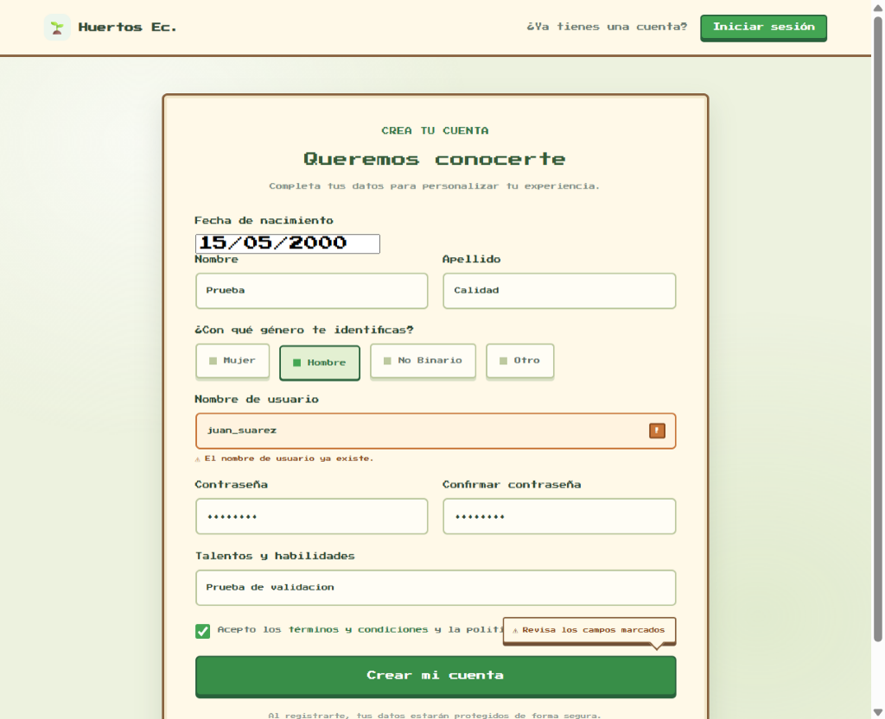

3. **Registro exitoso con el nuevo usuario `qa_huertos_1111`:**
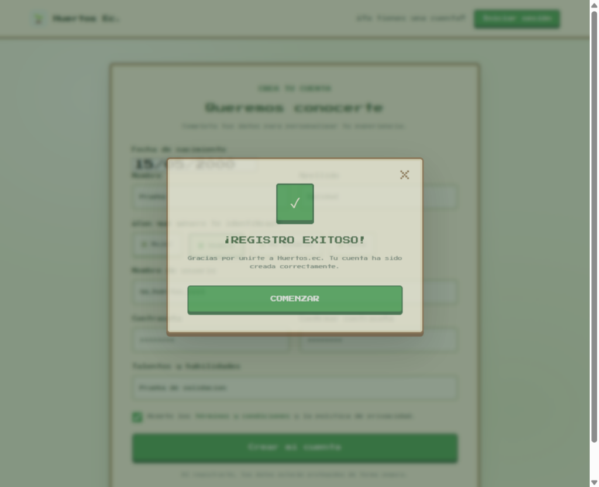

4. **Login exitoso con `juan_suarez`:**
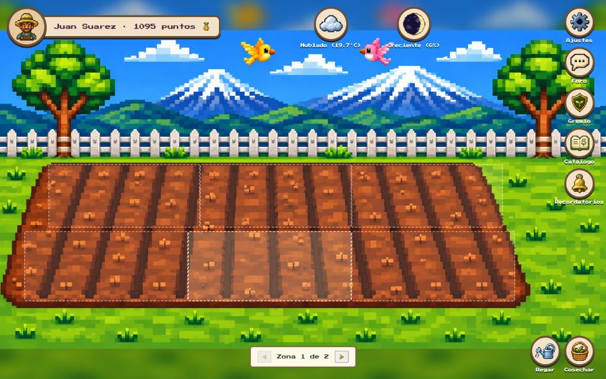

---

## P-002: Creación y ubicación real del gremio (HU-002)

<table class="hu-table">
  <tbody>
    <tr>
      <td class="hu-col-nro">
        
<strong>ID:</strong> P-002

      </td>
      <td class="hu-col-titulo">
        
<strong>Título: Creación y ubicación real del gremio (HU-002)</strong>

      </td>
      <td class="hu-col-meta">
        
<strong>Fecha:</strong> 11-noviembre-2026

        
<strong>Responsable:</strong> Emilio Camino

      </td>
    </tr>
    <tr>
      <td colspan="3">
        
<strong>Descripción:</strong>

        
Verificar la creación de un gremio con su ubicación real en el mapa, validando que el sistema impida guardar cuando no se ha seleccionado un punto en el mapa, permita buscar y marcar una ubicación, registre al usuario como Fundador, cree su huerto inicial y genere un código único de invitación de 6 dígitos.

      </td>
    </tr>
    <tr>
      <td colspan="3">
        
<strong>Procedimiento de prueba:</strong>

        <ol>
          <li>Con la sesión iniciada como <code>"qa_huertos_1111"</code> en el panel de selección de gremio, dar clic en <strong>"Crear un Gremio"</strong>.</li>
          <li>Dentro del panel de creación del gremio, llenar: Nombre del gremio (<code>"Huerto Prueba QA"</code>), Área total (<code>"200"</code>), Tipo de suelo (<code>"Arcilloso"</code>), Tipo de riego (<code>"Goteo"</code>), Descripción (<code>"Huerto comunitario de prueba QA"</code>), marcar <strong>"Acepto los términos y condiciones"</strong> y dar clic en <strong>"Enviar"</strong> sin elegir ubicación en el mapa.</li>
          <li>Dar clic en <strong>"Buscar o seleccionar en mapa"</strong> para seleccionar la ubicación del huerto, buscar <code>"Ambato"</code>, seleccionar el primer resultado de la lista y verificar el pin y coordenadas en el mapa.</li>
          <li>Dar clic en <strong>"Confirmar"</strong> y luego en <strong>"Enviar"</strong> en el formulario.</li>
          <li>En la pantalla del juego, dar clic en <strong>"Gremio"</strong> y verificar el rol del miembro y el código de invitación de 6 dígitos.</li>
        </ol>
      </td>
    </tr>
    <tr>
      <td colspan="3">
        
<strong>Resultados esperados:</strong>

        <ul>
          <li><strong>Paso 2:</strong> El sistema detiene el guardado y muestra el aviso <code>"Selecciona la ubicación del huerto en el mapa"</code>.</li>
          <li><strong>Paso 3:</strong> El mapa interactivo centra la vista en Ambato mostrando la dirección y sus coordenadas.</li>
          <li><strong>Paso 4:</strong> El sistema guarda el gremio y su huerto inicial, asigna el rol <code>"Fundador"</code> al usuario y lo redirige al panel del juego.</li>
          <li><strong>Paso 5:</strong> En <strong>"Gremio"</strong> aparece el usuario con rol <code>"Fundador"</code> y se muestra el código de invitación único de 6 dígitos junto con su código QR.</li>
        </ul>
      </td>
    </tr>
    <tr>
      <td colspan="2">
        
<strong>Resultados obtenidos:</strong>

        <ul>
          <li>Sin ubicación en mapa: mostró <code>"Selecciona la ubicación del huerto en el mapa"</code>.</li>
          <li>En el mapa: al buscar <code>"Ambato"</code> centró el marcador mostrando la ciudad y sus coordenadas geográficas.</li>
          <li>Al confirmar y enviar: creó el gremio <code>"Huerto Prueba QA"</code> y redirigió al panel del juego con los datos ingresados en el registro.</li>
          <li>En <strong>"Gremio"</strong>, el usuario tiene el rol <code>"Fundador"</code> y se obtuvo el código de invitación de 6 dígitos <code>"784189"</code> con su QR.</li>
        </ul>
      </td>
      <td>
        
<strong>Estado de Ejecución:</strong>

        
Reprobado ( &nbsp; )

        
<strong>Aprobado ( X )</strong>

      </td>
    </tr>
  </tbody>
</table>

**Capturas:**

1. **Intentar crear gremio sin seleccionar ubicación en el mapa:**
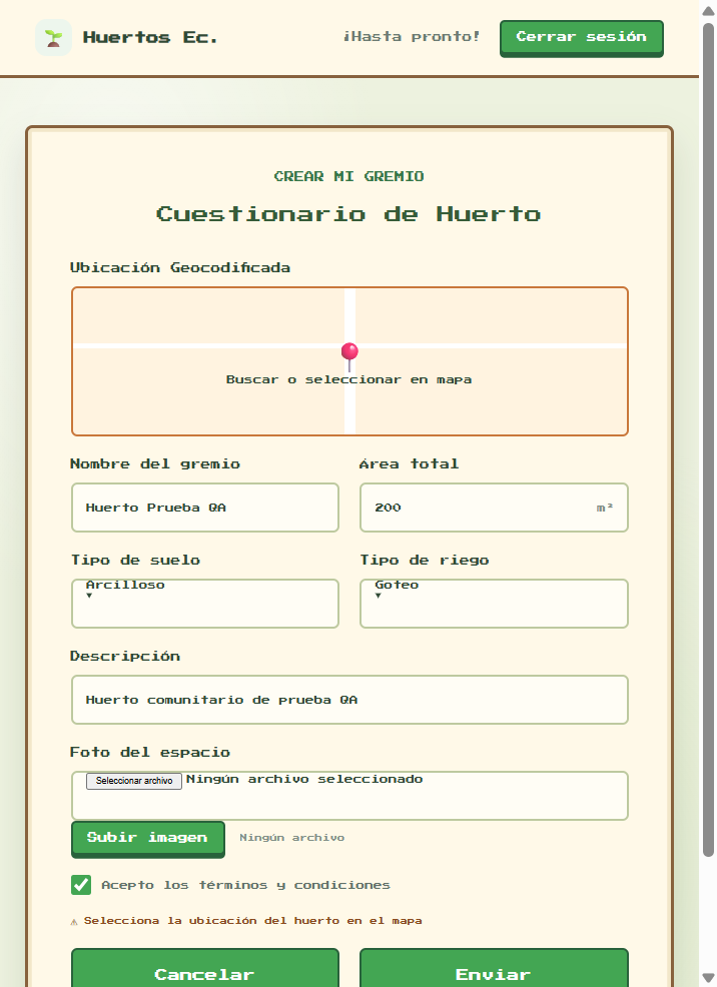

2. **Selección de ubicación real en el mapa:**
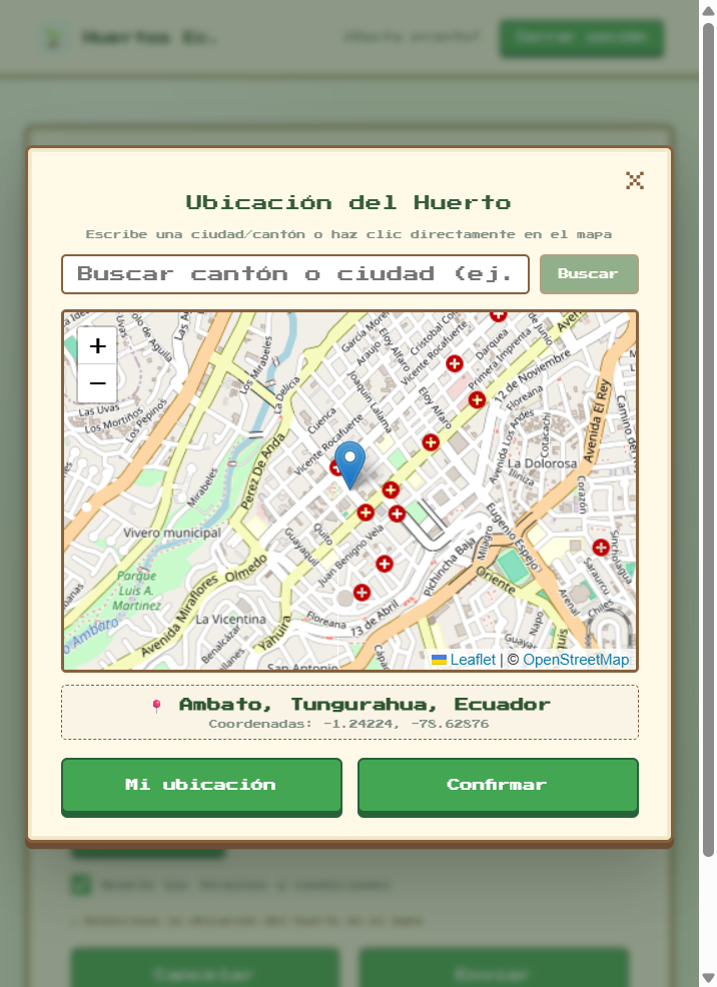

3. **Redirección a `/juego` con el huerto recién creado:**

4. **Gremio creado con código de invitación de 6 dígitos y QR:**
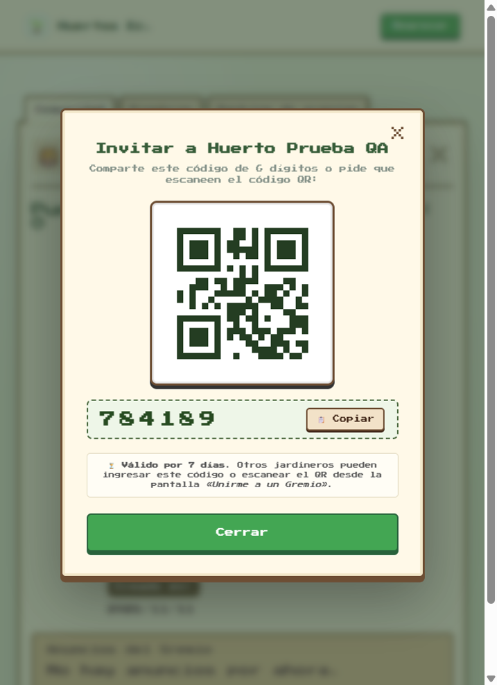

---

## P-003: Unirse a un gremio mediante código o código QR (HU-003)

<table class="hu-table">
  <tbody>
    <tr>
      <td class="hu-col-nro">
        
<strong>ID:</strong> P-003

      </td>
      <td class="hu-col-titulo">
        
<strong>Título: Unirse a un gremio mediante código o código QR (HU-003)</strong>

      </td>
      <td class="hu-col-meta">
        
<strong>Fecha:</strong> 11-noviembre-2026

        
<strong>Responsable:</strong> Karen Mosquera

      </td>
    </tr>
    <tr>
      <td colspan="3">
        
<strong>Descripción:</strong>

        
Verificar que un jugador sin gremio pueda unirse a una comunidad existente mediante su código de invitación de 6 dígitos (HU-003), rechace códigos inexistentes o expirados y lo redirija al huerto comunitario.

      </td>
    </tr>
    <tr>
      <td colspan="3">
        
<strong>Procedimiento de prueba:</strong>

        <ol>
          <li>Registrar e iniciar sesión con un jugador sin gremio.</li>
          <li>Dar clic en <strong>"Unirme a un Gremio"</strong> para abrir el modal <strong>"Unirme a un gremio"</strong>.</li>
          <li>Escribir un código incompleto de 3 dígitos (<code>"123"</code>) y verificar el estado del botón <strong>"Unirme"</strong>.</li>
          <li>Ingresar un código de 6 dígitos inexistente (<code>"999999"</code>) y dar clic en <strong>"Unirme"</strong>.</li>
          <li>Reemplazar el campo por el código válido de 6 dígitos del gremio <code>"Huerto Prueba QA"</code> (<code>"784189"</code>) y dar clic en <strong>"Unirme"</strong>.</li>
          <li>Dar clic en <strong>"Gremio"</strong> y abrir la pestaña <strong>"Miembros"</strong> para confirmar la incorporación.</li>
        </ol>
      </td>
    </tr>
    <tr>
      <td colspan="3">
        
<strong>Resultados esperados:</strong>

        <ul>
          <li><strong>Paso 3:</strong> El botón <strong>"Unirme"</strong> permanece deshabilitado mientras el código no tenga 6 dígitos.</li>
          <li><strong>Paso 4:</strong> El servidor rechaza el ingreso <code>"Invitación no encontrada."</code> sin unir al jugador.</li>
          <li><strong>Paso 5:</strong> El servidor vincula al usuario como miembro y lo redirige a la pantalla del huerto.</li>
          <li><strong>Paso 6:</strong> El jugador es un miembro del gremio con rol <code>"Aprendiz"</code> y estado <code>"en línea"</code>.</li>
        </ul>
      </td>
    </tr>
    <tr>
      <td colspan="2">
        
<strong>Resultados obtenidos:</strong>

        <ul>
          <li>Código incompleto: el botón <strong>"Unirme"</strong> permaneció deshabilitado.</li>
          <li>Código inexistente: mostró <code>"Invitación no encontrada"</code>.</li>
          <li>Código válido: redirigió a la pantalla principal del gremio.</li>
          <li>En la pantalla de miembros: figuró <code>"Miembros - Gremio: Huerto Prueba QA"</code> con el fundador y Carlos Mendoza (<code>Aprendiz</code>).</li>
        </ul>
      </td>
      <td>
        
<strong>Estado de Ejecución:</strong>

        
Reprobado ( &nbsp; )

        
<strong>Aprobado ( X )</strong>

      </td>
    </tr>
  </tbody>
</table>

**Capturas:**

1. **Rechazo de código inexistente (`999999`) en el modal "Unirme a un gremio":**
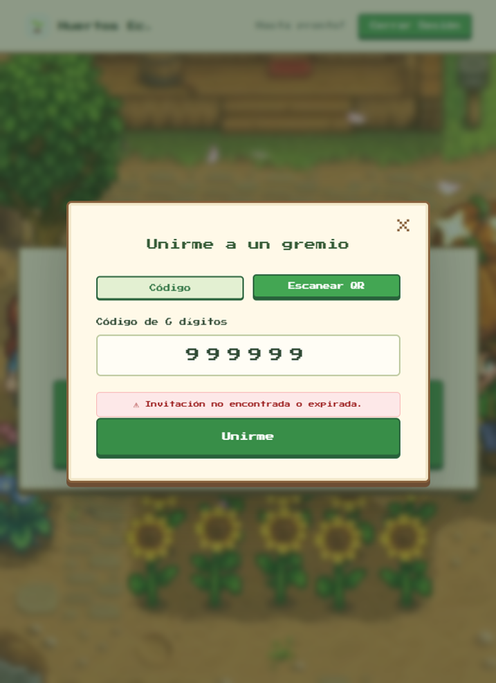

2. **Ingreso directo al huerto tras ingresar el código válido `784189`:**
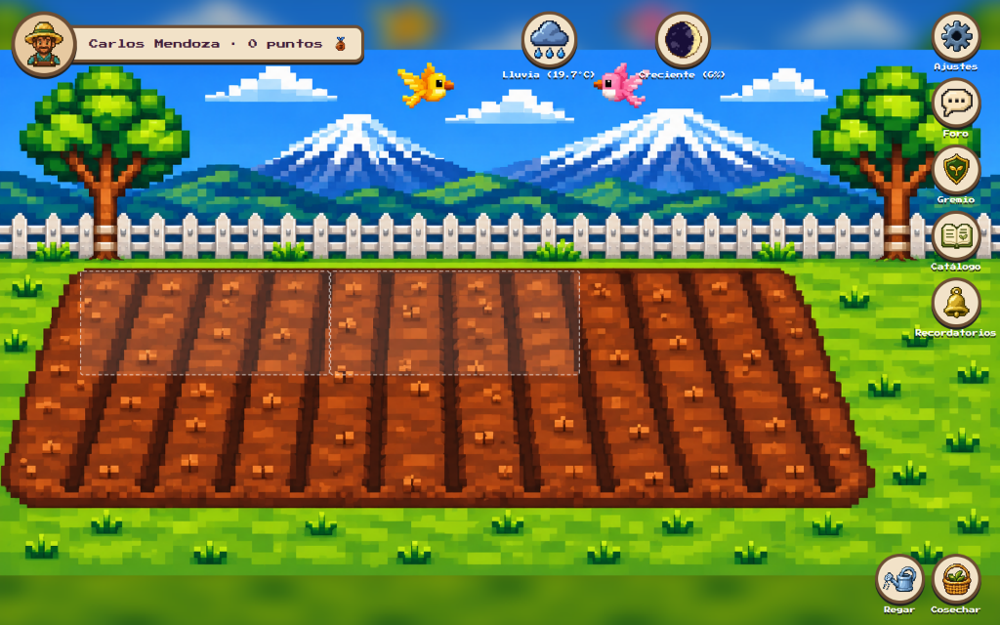

3. **Verificación del miembro con rol Aprendiz:**
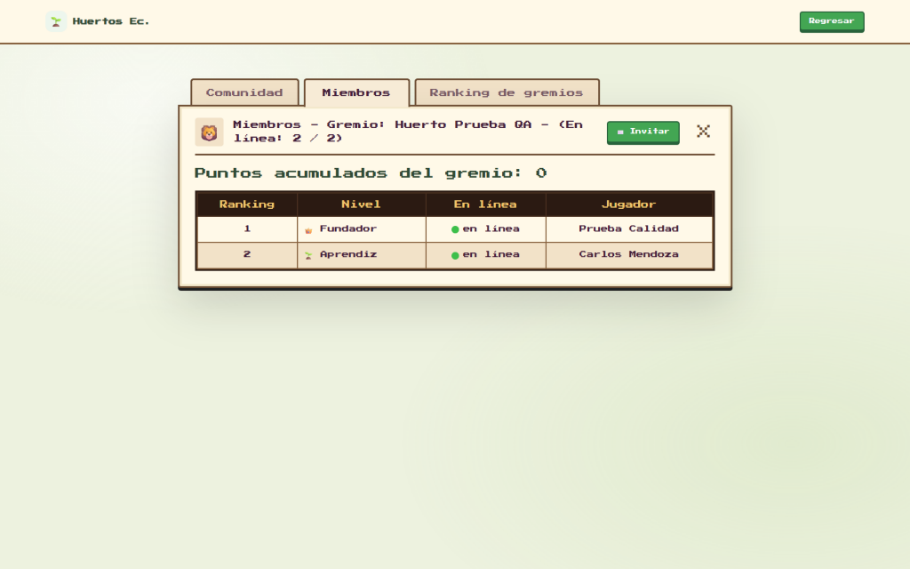

---

## P-004: Consulta y filtrado del catálogo de plantas ecuatorianas (HU-004)

<table class="hu-table">
  <tbody>
    <tr>
      <td class="hu-col-nro">
        
<strong>ID:</strong> P-004

      </td>
      <td class="hu-col-titulo">
        
<strong>Título: Consulta y filtrado del catálogo de plantas ecuatorianas (HU-004)</strong>

      </td>
      <td class="hu-col-meta">
        
<strong>Fecha:</strong> 11-noviembre-2026

        
<strong>Responsable:</strong> Karen Mosquera

      </td>
    </tr>
    <tr>
      <td colspan="3">
        
<strong>Descripción:</strong>

        
Verificar que un jugador pueda consultar el catálogo de plantas medicinales ecuatorianas, filtrar por región y buscar por nombre, abrir el modal de detalle con la información de cuidado y fases de cultivo.

      </td>
    </tr>
    <tr>
      <td colspan="3">
        
<strong>Procedimiento de prueba:</strong>

        <ol>
          <li>Ingresar al catálogo de plantas con sesión iniciada y confirmar la carga de plantas.</li>
          <li>Escribir un término inexistente en el buscador para verificar el manejo de resultados vacíos.</li>
          <li>Borrar la búsqueda, seleccionar la región <code>"Sierra"</code> y combinar con la búsqueda <code>"Manzanilla"</code>.</li>
          <li>Dar clic sobre la tarjeta de <code>"Manzanilla"</code> para abrir la ventana de detalle y revisar los datos desplegados.</li>
        </ol>
      </td>
    </tr>
    <tr>
      <td colspan="3">
        
<strong>Resultados esperados:</strong>

        <ul>
          <li><strong>Paso 1:</strong> Se cargan y muestran las tarjetas de plantas registradas en la base de datos.</li>
          <li><strong>Paso 2:</strong> Se muestra un mensaje indicando que no se encontraron coincidencias.</li>
          <li><strong>Paso 3:</strong> Al seleccionar <code>"Sierra"</code> y buscar <code>"Manzanilla"</code>, se filtra mostrando la planta buscada.</li>
          <li><strong>Paso 4:</strong> Se abre la ventana modal con la región, cuidados y fases de cultivo.</li>
        </ul>
      </td>
    </tr>
    <tr>
      <td colspan="2">
        
<strong>Resultados obtenidos:</strong>

        <ul>
          <li>Carga inicial: se listaron 31 plantas.</li>
          <li>Búsqueda incorrecta: mostró el mensaje <code>"No se encontraron plantas con esos filtros."</code>.</li>
          <li>Filtro región: al filtrar por <code>"Sierra"</code> mostró 27 plantas y al combinar con <code>"Manzanilla"</code> filtró la tarjeta correspondiente.</li>
          <li>Modal de <code>"Manzanilla"</code>: mostró <code>"Planta medicinal · Sierra"</code>, pestañas Cuidados y Fases.</li>
        </ul>
      </td>
      <td>
        
<strong>Estado de Ejecución:</strong>

        
Reprobado ( &nbsp; )

        
<strong>Aprobado ( X )</strong>

      </td>
    </tr>
  </tbody>
</table>

**Capturas:**

1. **Mensaje de estado vacío al buscar `"PlantaInexistenteXYZ"` en `/catalogo-plantas`:**
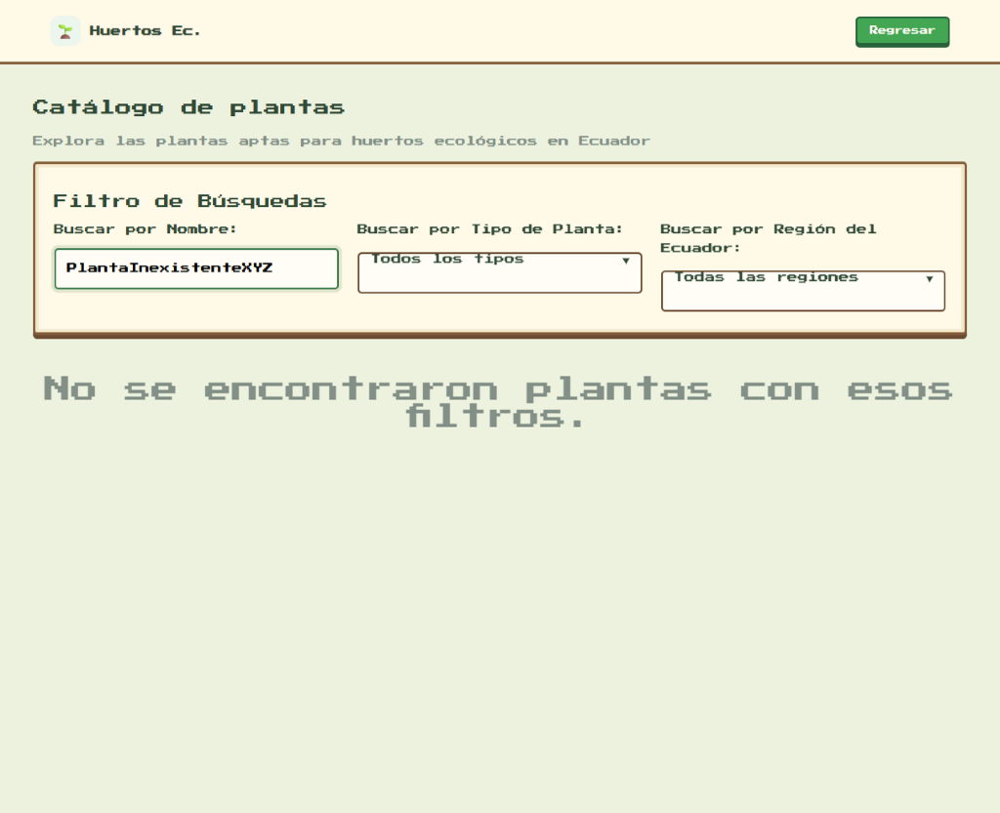

2. **Ventana modal de detalle de `"Manzanilla"` filtrada en región Sierra:**
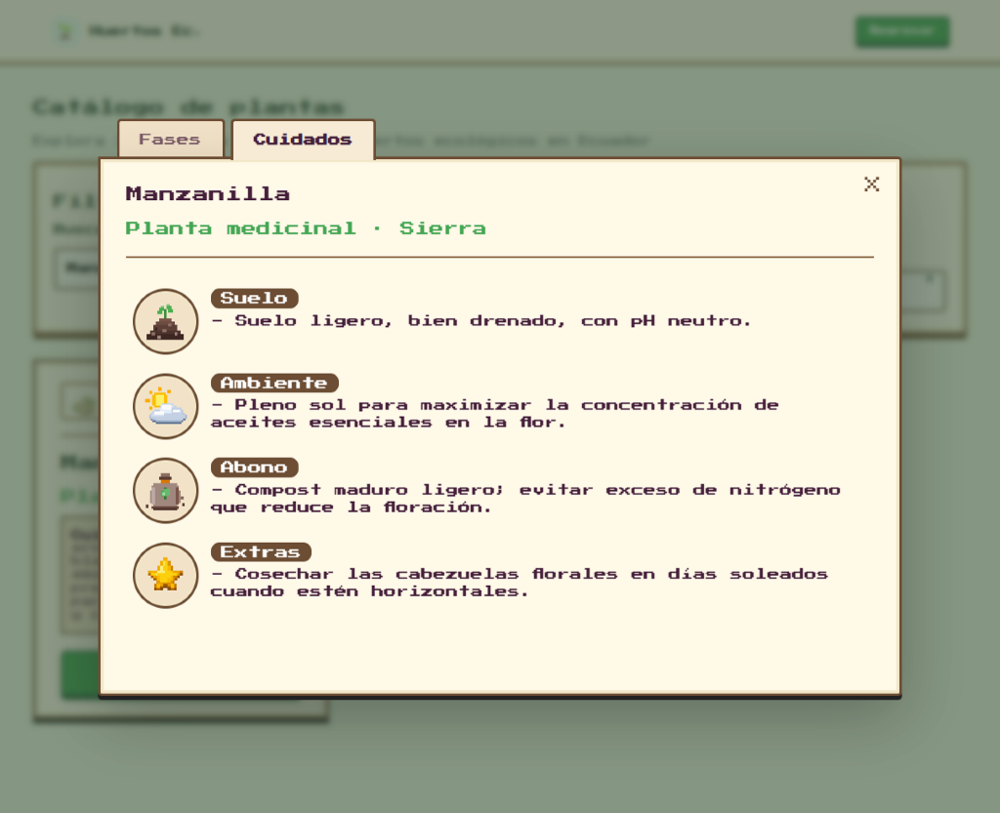

---

## P-005: Siembra por parcelas y visualización del crecimiento en el huerto (HU-005)

<table class="hu-table">
  <tbody>
    <tr>
      <td class="hu-col-nro">
        
<strong>ID:</strong> P-005

      </td>
      <td class="hu-col-titulo">
        
<strong>Título: Siembra por parcelas y visualización del crecimiento en el huerto (HU-005)</strong>

      </td>
      <td class="hu-col-meta">
        
<strong>Fecha:</strong> 12-noviembre-2026

        
<strong>Responsable:</strong> Oscar Tamayo

      </td>
    </tr>
    <tr>
      <td colspan="3">
        
<strong>Descripción:</strong>

        
Verificar que la siembra se habilite al preparar la parcela, respete el límite de plantas y muestre el crecimiento del cultivo.

      </td>
    </tr>
    <tr>
      <td colspan="3">
        
<strong>Procedimiento de prueba:</strong>

        <ol>
          <li>Iniciar sesión con <code>"qa_huertos_03"</code>. Elegir manzanilla en Zona 1 · Parcela 2 (100 m²) sin preparar, seleccionar Flores y confirmar el ritual.</li>
          <li>Ingresar 500 plantas. Cambiar a 400 y pulsar <strong>"Sembrar"</strong> para comprobar el requisito de preparación.</li>
          <li>Abrir Actividades, seleccionar la Parcela 2 e iniciar la preparación. Completar <strong>"Retirar maleza"</strong> y <strong>"Preparar la tierra"</strong>. Usar el modo de prueba si la fecha, la hora o la fase lunar impiden avanzar.</li>
          <li>Sembrar 400 plantas de manzanilla en la Parcela 2.</li>
          <li>Abrir el detalle del cultivo para revisar su crecimiento.</li>
        </ol>
      </td>
    </tr>
    <tr>
      <td colspan="3">
        
<strong>Resultados esperados:</strong>

        <ul>
          <li><strong>Paso 2:</strong> El formulario deshabilita <strong>"Sembrar"</strong> con 500 plantas y exige preparar la parcela al intentar sembrar con 400.</li>
          <li><strong>Pasos 3 y 4:</strong> Una vez preparada la parcela, el sistema registra la siembra y muestra el contador de plantas.</li>
          <li><strong>Paso 5:</strong> El detalle muestra la cantidad, la fase de crecimiento, los días restantes y el estado de riego.</li>
        </ul>
      </td>
    </tr>
    <tr>
      <td colspan="2">
        
<strong>Resultados obtenidos:</strong>

        <ul>
          <li>Con 500 plantas, <strong>"Sembrar"</strong> quedó deshabilitado y el formulario indicó un máximo de 400.</li>
          <li>Con 400 plantas, el sistema solicitó preparar la parcela. En modo normal también indicó que la fecha estaba fuera de la ventana lunar permitida.</li>
          <li>Se inició la preparación desde Actividades. La siembra posterior quedó registrada con el contador <code>×400</code> y el aviso de 30 puntos.</li>
          <li>El detalle de Manzanilla (<em>Matricaria chamomilla</em>) mostró 400 plantas, fase 1 de 4 (Germinación), 90 días hasta la fase visual de cosecha y un aviso de riego.</li>
        </ul>
      </td>
      <td>
        
<strong>Estado de Ejecución:</strong>

        
Reprobado ( &nbsp; )

        
<strong>Aprobado ( X )</strong>

      </td>
    </tr>
  </tbody>
</table>

**Capturas:**

1. **El formulario deshabilitó la siembra de 500 plantas de manzanilla (límite de Parcela 2: 400):**
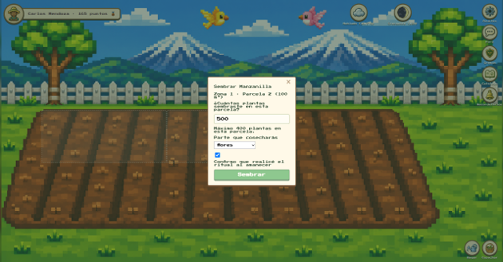

2. **Con 400 plantas, el sistema pidió cargar las actividades y preparar la parcela:**
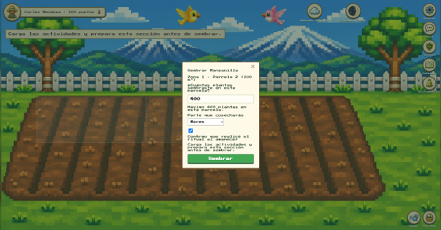

3. **La pestaña Actividades mostró la opción de iniciar la preparación de la Parcela 2:**
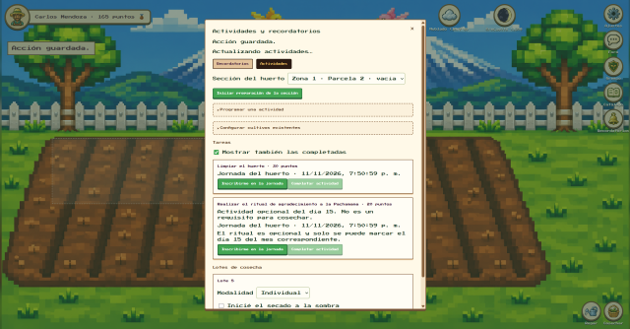

4. **En modo normal, el sistema indicó que faltaba completar la preparación y que la fecha estaba fuera de la ventana lunar permitida:**
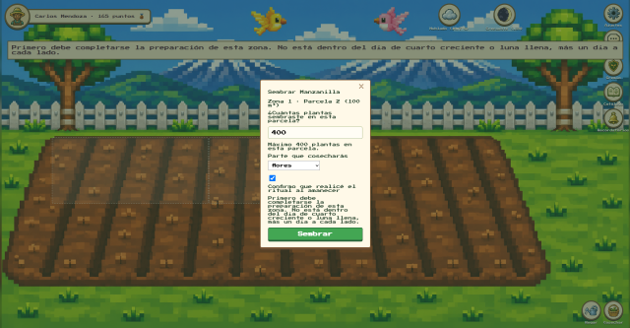

5. **La Parcela 2 mostró el contador ×400 después de guardar la siembra y otorgó 30 puntos:**
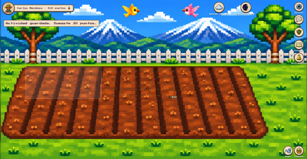

6. **El detalle de Manzanilla mostró 400 plantas en germinación (fase 1 de 4):**
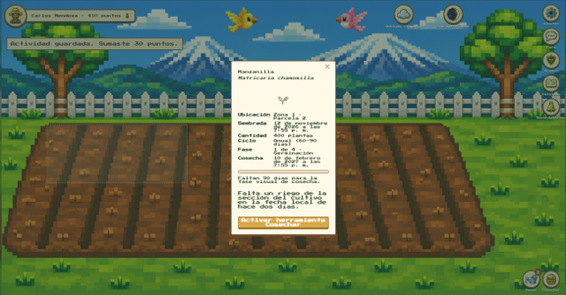

---

## P-006: Consulta del clima actual y la fase lunar en el huerto (HU-006)

<table class="hu-table">
  <tbody>
    <tr>
      <td class="hu-col-nro">
        
<strong>ID:</strong> P-006

      </td>
      <td class="hu-col-titulo">
        
<strong>Título: Consulta del clima actual y la fase lunar en el huerto (HU-006)</strong>

      </td>
      <td class="hu-col-meta">
        
<strong>Fecha:</strong> 12-noviembre-2026

        
<strong>Responsable:</strong> Oscar Tamayo

      </td>
    </tr>
    <tr>
      <td colspan="3">
        
<strong>Descripción:</strong>

        
Verificar que el huerto muestre el clima de su ubicación, el pronóstico y la fase lunar con sus consejos de cultivo.

      </td>
    </tr>
    <tr>
      <td colspan="3">
        
<strong>Procedimiento de prueba:</strong>

        <ol>
          <li>Iniciar sesión con <code>"juan_suarez"</code> y entrar al huerto.</li>
          <li>Abrir el indicador de clima y revisar las condiciones actuales y el pronóstico.</li>
          <li>Abrir el indicador de fase lunar y revisar la iluminación, el próximo evento y el consejo de cultivo.</li>
        </ol>
      </td>
    </tr>
    <tr>
      <td colspan="3">
        
<strong>Resultados esperados:</strong>

        <ul>
          <li><strong>Paso 2:</strong> El panel muestra las condiciones meteorológicas y el pronóstico del huerto.</li>
          <li><strong>Paso 3:</strong> El panel muestra la fase lunar, el porcentaje de iluminación y el consejo de cultivo.</li>
        </ul>
      </td>
    </tr>
    <tr>
      <td colspan="2">
        
<strong>Resultados obtenidos:</strong>

        <ul>
          <li>El panel mostró cielo nublado, 12,8 °C, 85 % de humedad y 0 mm de lluvia. El pronóstico indicó de 9 a 20 °C y un 31 % de probabilidad de lluvia.</li>
          <li>El panel mostró luna creciente con 13 % de iluminación y señaló el cuarto creciente del 17 de noviembre como próximo evento. El consejo indicó que esta fase favorece el crecimiento vegetativo.</li>
        </ul>
      </td>
      <td>
        
<strong>Estado de Ejecución:</strong>

        
Reprobado ( &nbsp; )

        
<strong>Aprobado ( X )</strong>

      </td>
    </tr>
  </tbody>
</table>

**Capturas:**

1. **El panel de clima mostró cielo nublado, 12,8 °C, 85 % de humedad y pronóstico de 9 a 20 °C con 31 % de probabilidad de lluvia:**
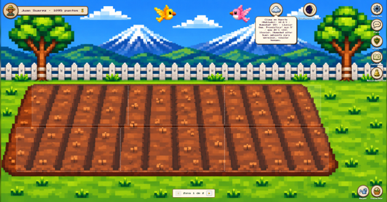

2. **El panel lunar mostró luna creciente con 13 % de iluminación, fecha del próximo cuarto creciente y consejo de cultivo:**
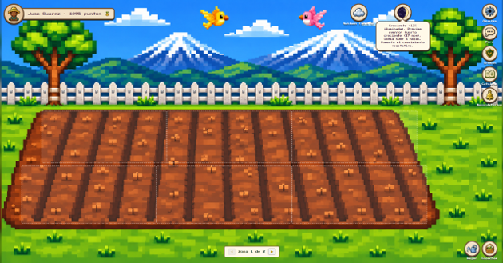

---

## P-007: Completar recordatorios, cosechar plantas y sumar puntos (HU-007)

<table class="hu-table">
  <tbody>
    <tr>
      <td class="hu-col-nro">
        
<strong>ID:</strong> P-007

      </td>
      <td class="hu-col-titulo">
        
<strong>Título: Completar recordatorios, cosechar plantas y sumar puntos (HU-007)</strong>

      </td>
      <td class="hu-col-meta">
        
<strong>Fecha:</strong> 11-noviembre-2026

        
<strong>Responsable:</strong> Jorge Oviedo

      </td>
    </tr>
    <tr>
      <td colspan="3">
        
<strong>Descripción:</strong>

        
Verificar que el jugador pueda completar actividades/recordatorios (riego, señalética, abono) y cosechar plantas para acumular puntos personales y del gremio sin duplicar recompensas, además de ver su posición por la cantidad de puntos acumulados dentro de su gremio.

      </td>
    </tr>
    <tr>
      <td colspan="3">
        
<strong>Procedimiento de prueba:</strong>

        <ol>
          <li>Con <code>"qa_huertos_03"</code> (<code>"Carlos Mendoza"</code>, 75 puntos y Rango <code>"Aprendiz"</code>) en <code>/juego</code> con Manzanilla en Parcela 1, activar la herramienta <strong>"Regar"</strong> y regar Parcela 1.</li>
          <li>Abrir <strong>"Recordatorios"</strong> &rarr; pestaña <strong>"Actividades"</strong> en Zona 1 · Parcela 1 y completar <strong>"Colocar señalética"</strong> (25 pts) y <strong>"Aplicar abono orgánico"</strong> (20 pts).</li>
          <li>Activar la herramienta <strong>"Cosechar"</strong>, hacer clic en Parcela 1, marcar confirmaciones obligatorias, elegir <strong>"Finalizar el cultivo y liberar la sección"</strong> y pulsar <strong>"Cosechar · 35 puntos"</strong>.</li>
          <li>Activar <strong>"Mostrar también las completadas"</strong> en Actividades para confirmar que las tareas completadas impiden cobrar puntos dobles y revisar en <code>/gremio</code> el puntaje acumulado del gremio.</li>
        </ol>
      </td>
    </tr>
    <tr>
      <td colspan="3">
        
<strong>Resultados esperados:</strong>

        <ul>
          <li><strong>Pasos 1-3:</strong> Cada acción suma sus puntos exactos al jugador (75 &rarr; 80 &rarr; 110 &rarr; 130 &rarr; 165 puntos) y libera Parcela 1 tras la cosecha.</li>
          <li><strong>Paso 4:</strong> Las tareas marcadas como <code>"Completada"</code> y cultivos ya cosechados impiden volver a sumar puntos; <code>/gremio</code> refleja 165 puntos acumulados en <code>"Huerto Prueba QA"</code>.</li>
        </ul>
      </td>
    </tr>
    <tr>
      <td colspan="2">
        
<strong>Resultados obtenidos:</strong>

        <ul>
          <li>Riego y actividades: Regar sumó +5 pts (80 pts); <strong>"Colocar señalética"</strong> +25 pts (110 pts); <strong>"Aplicar abono orgánico"</strong> +20 pts (130 pts); y <strong>"Cosechar Manzanilla"</strong> +35 pts (165 pts), liberando Parcela 1 y creando Lote 5.</li>
          <li>Prevención de duplicidad y gremio: las tareas quedaron como <code>"Completada"</code> sin permitir re-cobro y <code>"Huerto Prueba QA"</code> actualizó <code>"Puntos acumulados del gremio: 165"</code> en <code>/gremio</code>.</li>
          <li>Visualización de los puntos de Carlos Mendoza, quien ha alcanzado un total de 165 puntos junto con el nombre de su gremio y su posición dentro de este.</li>
        </ul>
      </td>
      <td>
        
<strong>Estado de Ejecución:</strong>

        
Reprobado ( &nbsp; )

        
<strong>Aprobado ( X )</strong>

      </td>
    </tr>
  </tbody>
</table>

**Capturas:**

1. **Actividades completadas, Lote 5 generado tras cosecha y puntaje de Carlos Mendoza en 165 puntos:**
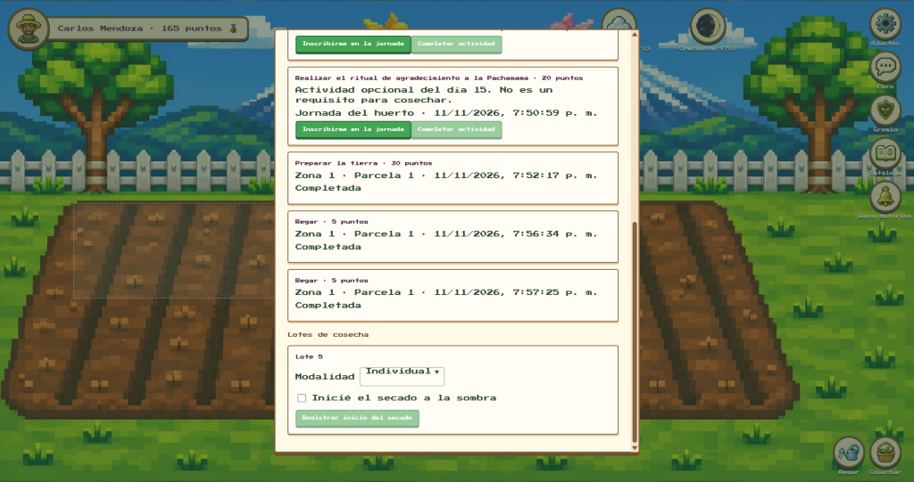

2. **En Mi Perfil: se visualizan los 165 puntos totales, el gremio al que pertenece y su posición actual:**
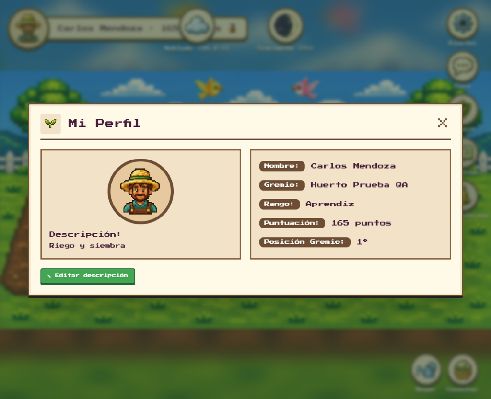

---

## P-008: Ver perfil del jugador y editar descripción de habilidades (HU-008)

<table class="hu-table">
  <tbody>
    <tr>
      <td class="hu-col-nro">
        
<strong>ID:</strong> P-008

      </td>
      <td class="hu-col-titulo">
        
<strong>Título: Ver perfil del jugador y editar descripción de habilidades (HU-008)</strong>

      </td>
      <td class="hu-col-meta">
        
<strong>Fecha:</strong> 11-noviembre-2026

        
<strong>Responsable:</strong> Velky Jibaja

      </td>
    </tr>
    <tr>
      <td colspan="3">
        
<strong>Descripción:</strong>

        
Verificar que el jugador pueda abrir su ventana de perfil desde el panel principal para consultar su nombre, gremio, rango, puntuación, posición y editar/guardar su descripción de habilidades respetando el límite máximo de 120 caracteres.

      </td>
    </tr>
    <tr>
      <td colspan="3">
        
<strong>Procedimiento de prueba:</strong>

        <ol>
          <li>Iniciar sesión con el usuario <code>"juan_suarez"</code> y acceder al panel principal.</li>
          <li>Dar clic en la placa del jugador (<code>"Juan Suarez · 1095 puntos"</code>) para abrir el modal <strong>"Mi Perfil"</strong>.</li>
          <li>Pulsar <strong>"Editar descripción"</strong>, intentar ingresar un texto de 150 caracteres para verificar el tope de 120 caracteres.</li>
          <li>Reemplazar por <code>"Experto en cultivos andinos, riego por goteo y compostaje comunitario."</code> y pulsar <strong>"Guardar"</strong>.</li>
          <li>Cerrar el modal <strong>"Mi Perfil"</strong> y volver a abrirlo para comprobar la persistencia del texto guardado en la base de datos.</li>
        </ol>
      </td>
    </tr>
    <tr>
      <td colspan="3">
        
<strong>Resultados esperados:</strong>

        <ul>
          <li><strong>Paso 2:</strong> El modal muestra Nombre, Gremio, Rango, Puntuación, Posición Gremio y descripción actual.</li>
          <li><strong>Paso 3:</strong> El sistema limita o avisa sobre el máximo de 120 caracteres sin perder la edición en curso.</li>
          <li><strong>Pasos 4-5:</strong> Los cambios se guardan en el servidor y permanecen visibles al reabrir el perfil.</li>
        </ul>
      </td>
    </tr>
    <tr>
      <td colspan="2">
        
<strong>Resultados obtenidos:</strong>

        <ul>
          <li>Al abrir el modal Mi Perfil mostró: Nombre <code>"Juan Suarez"</code>, Gremio <code>"Prueba Gremio"</code>, Rango <code>"Miembro"</code>, Puntuación <code>"1095 puntos"</code>, Posición Gremio <code>"1º"</code> y descripción inicial <code>"JS"</code>.</li>
          <li>Al ingresar 150 caracteres, el campo aplicó el límite truncando a 120 caracteres con contador visible <code>"120 / 120"</code>.</li>
          <li>Al guardar <code>"Experto en cultivos andinos, riego por goteo y compostaje comunitario."</code>, cerrar y reabrir el modal, la nueva descripción se mantuvo persistida correctamente.</li>
        </ul>
      </td>
      <td>
        
<strong>Estado de Ejecución:</strong>

        
Reprobado ( &nbsp; )

        
<strong>Aprobado ( X )</strong>

      </td>
    </tr>
  </tbody>
</table>

**Capturas:**

1. **Modal Mi Perfil de Juan Suarez mostrando datos reales y descripción actualizada persistida:**
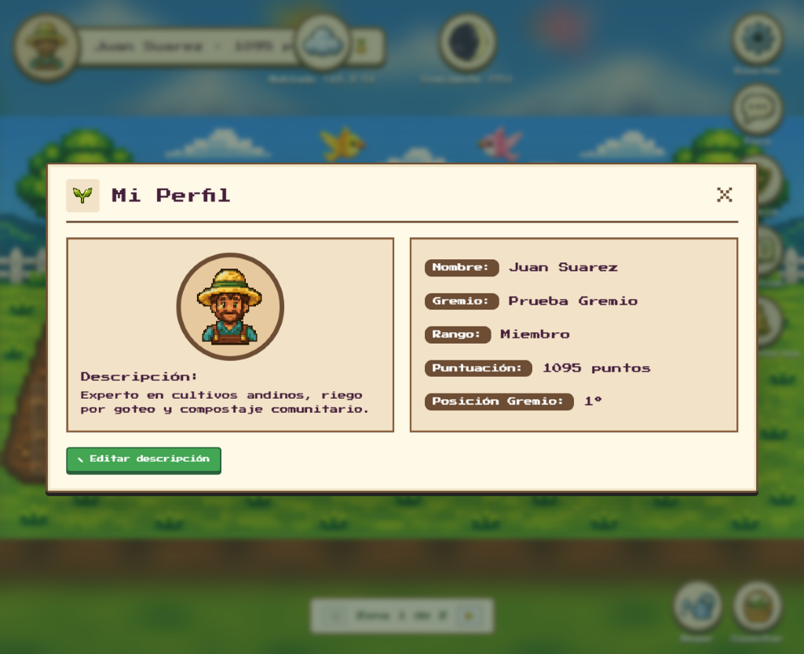

---

## P-009: Ver miembros en línea y consultar el ranking de gremios (HU-009)

<table class="hu-table">
  <tbody>
    <tr>
      <td class="hu-col-nro">
        
<strong>ID:</strong> P-009

      </td>
      <td class="hu-col-titulo">
        
<strong>Título: Ver miembros en línea y consultar el ranking de gremios (HU-009)</strong>

      </td>
      <td class="hu-col-meta">
        
<strong>Fecha:</strong> 11-noviembre-2026

        
<strong>Responsable:</strong> Velky Jibaja

      </td>
    </tr>
    <tr>
      <td colspan="3">
        
<strong>Descripción:</strong>

        
Verificar que en el panel gremio la pestaña <strong>"Miembros"</strong> muestre el contador de usuarios conectados en línea vs desconectados ordenados por puntos, la pestaña <strong>"Ranking de gremios"</strong> permita actualizar y visualizar los gremios ordenados por puntaje acumulado, y el servidor rechace reportes de presencia sin sesión activa.

      </td>
    </tr>
    <tr>
      <td colspan="3">
        
<strong>Procedimiento de prueba:</strong>

        <ol>
          <li>Con sesión iniciada con el usuario <code>"juan_suarez"</code> en el panel principal, navegar al panel gremio por medio del botón <strong>"gremio"</strong> presente en el panel principal.</li>
          <li>Revisar la pestaña <strong>"Miembros"</strong>: encabezado de conectados (<code>"En línea: X / Total"</code>), lista ordenada y estado (<code>"en línea"</code> / <code>"desconectado"</code>).</li>
          <li>Cambiar a la pestaña <strong>"Ranking de gremios"</strong> y pulsar el botón <strong>"Actualizar ranking"</strong>.</li>
          <li>Enviar una petición sin sesión activa para verificar el control de acceso.</li>
        </ol>
      </td>
    </tr>
    <tr>
      <td colspan="3">
        
<strong>Resultados esperados:</strong>

        <ul>
          <li><strong>Paso 2:</strong> Muestra <code>"(En línea: 1 / 3 )"</code> con Juan Suarez marcado <code>"en línea"</code> y los demás miembros <code>"desconectado"</code>.</li>
          <li><strong>Paso 3:</strong> Muestra la tabla de gremios ordenada de mayor a menor puntaje acumulado con nombre, puntos y miembros.</li>
          <li><strong>Paso 4:</strong> El backend rechaza la petición sin sesión con código HTTP 401.</li>
        </ul>
      </td>
    </tr>
    <tr>
      <td colspan="2">
        
<strong>Resultados obtenidos:</strong>

        <ul>
          <li>Pestaña Miembros: mostró <code>"Miembros - Gremio: Prueba Gremio - (En línea: 1 / 3 )"</code>, listando a Juan Suarez (Miembro, <code>"en línea"</code>), Juanito Perez (Oficial, <code>"desconectado"</code>) y Patricia Reyes (Maestro, <code>"desconectado"</code>).</li>
          <li>Pestaña Ranking de gremios tras pulsar <strong>"Actualizar ranking"</strong>: mostró 1º <code>"Prueba Gremio"</code> (1195 puntos, 3 miembros), 2º <code>"Tungurahua"</code> (0 puntos, 1 miembro) y 3º <code>"Huerto Prueba QA"</code> (0 puntos, 2 miembros antes de la siembra QA).</li>
          <li>Petición sin autenticación: muestra el mensaje <code>"Tu sesión terminó. Inicia sesión nuevamente"</code>.</li>
        </ul>
      </td>
      <td>
        
<strong>Estado de Ejecución:</strong>

        
Reprobado ( &nbsp; )

        
<strong>Aprobado ( X )</strong>

      </td>
    </tr>
  </tbody>
</table>

**Capturas:**

1. **Pestaña Ranking de gremios en `/gremio` tras pulsar "Actualizar ranking":**
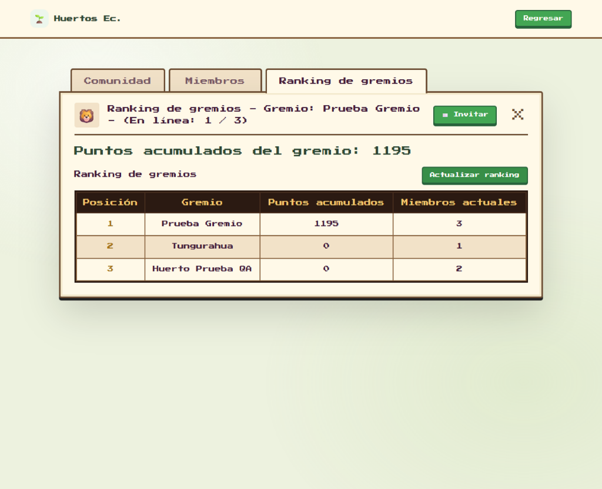

---

## P-010: Edición de la descripción y anuncios del gremio por Oficiales y Maestros (HU-010)

<table class="hu-table">
  <tbody>
    <tr>
      <td class="hu-col-nro">
        
<strong>ID:</strong> P-010

      </td>
      <td class="hu-col-titulo">
        
<strong>Título: Edición de la descripción y anuncios del gremio por Oficiales y Maestros (HU-010)</strong>

      </td>
      <td class="hu-col-meta">
        
<strong>Fecha:</strong> 11-noviembre-2026

        
<strong>Responsable:</strong> Mateo Aguirre

      </td>
    </tr>
    <tr>
      <td colspan="3">
        
<strong>Descripción:</strong>

        
Validar que únicamente los usuarios con rango Oficial o Maestro puedan editar la descripción y los anuncios del gremio, comprobando la visibilidad de las opciones de edición en la sección <strong>"Comunidad"</strong>, el rechazo de modificaciones no autorizadas y el cumplimiento de las restricciones de longitud establecidas.

      </td>
    </tr>
    <tr>
      <td colspan="3">
        
<strong>Procedimiento de prueba:</strong>

        <ol>
          <li>Iniciar sesión con el usuario <code>"juan_suarez"</code>, con rol <code>"Miembro"</code> en Prueba Gremio, y acceder a <code>/gremio</code>, ingresando a la pestaña <strong>"Comunidad"</strong>.</li>
          <li>Comprobar que no se muestre ningún botón de edición para la descripción ni los anuncios del gremio.</li>
          <li>Enviar una petición <code>PATCH</code> a <code>/api/gremios/1/perfil</code>, autenticado como <code>"juan_suarez"</code>, intentando modificar la descripción del gremio.</li>
          <li>Ejecutar la suite automatizada del backend mediante <code>node --test test/guildProfile.test.js</code> para verificar los permisos de edición, los límites de caracteres y el rechazo de modificaciones por roles no autorizados.</li>
        </ol>
      </td>
    </tr>
    <tr>
      <td colspan="3">
        
<strong>Resultados esperados:</strong>

        <ul>
          <li><strong>Paso 2:</strong> El sistema muestra la descripción y los anuncios del gremio en modo solo lectura, sin botones de edición para el usuario con rol Miembro.</li>
          <li><strong>Paso 3:</strong> El backend rechaza la modificación y responde con HTTP 403, mostrando el mensaje <code>"Solo Oficial y Maestro pueden editar la descripción y los anuncios del gremio."</code>.</li>
          <li><strong>Paso 4:</strong> Las pruebas unitarias confirman que los usuarios Oficial y Maestro pueden editar la descripción y los anuncios dentro de los límites de 120 y 160 caracteres, respectivamente, mientras que los roles Fundador, Aprendiz, Miembro y usuarios externos reciben una respuesta HTTP 403.</li>
        </ul>
      </td>
    </tr>
    <tr>
      <td colspan="2">
        
<strong>Resultados obtenidos:</strong>

        <ul>
          <li>La pestaña Comunidad, al ingresar como <code>"juan_suarez"</code> (Miembro), mostró la descripción y los anuncios del gremio sin botones de edición.</li>
          <li>La petición <code>PATCH</code> realizada como Miembro fue rechazada por el backend con HTTP 403 y el mensaje correspondiente de permisos insuficientes.</li>
          <li>La suite <code>test/guildProfile.test.js</code> finalizó con 8 de 8 pruebas aprobadas, verificando la edición por Oficial y Maestro, los límites de 120 y 160 caracteres y el rechazo de modificaciones por roles no autorizados.</li>
        </ul>
      </td>
      <td>
        
<strong>Estado de Ejecución:</strong>

        
Reprobado ( &nbsp; )

        
<strong>Aprobado ( X )</strong>

      </td>
    </tr>
  </tbody>
</table>

**Capturas:**

1. **Pestaña Comunidad en `/gremio` vista por rol Miembro sin botón de edición:**
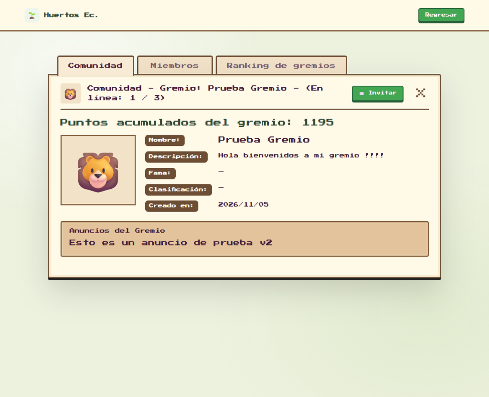
