# Diseño del Producto

Esta sección presenta el diseño de la base de datos en Supabase, los diagramas de secuencia de las historias de usuario implementadas y las reglas de rangos y actividades del juego.

---

## 1. Diseño de Base de Datos (Modelo Entidad-Relación)

La base de datos en PostgreSQL (esquema `huertos` en Supabase) está organizada en 4 dominios:

### 1.1. Modelo Entidad-Relación Completo

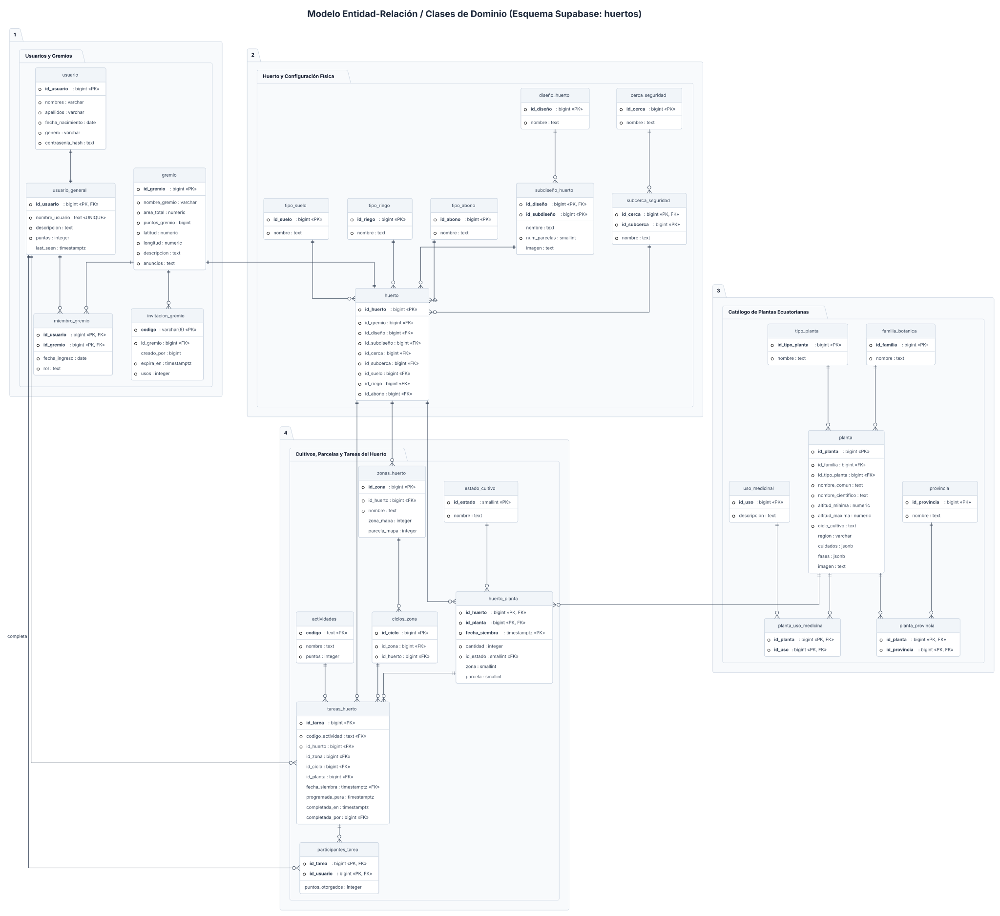

---

### 1.2. Dominio 1: Usuarios y Gremios

Guarda las cuentas de los jugadores (`usuario` y `usuario_general`), los datos de cada comunidad (`gremio`), los miembros con su rol (`miembro_gremio`) y los códigos de invitación de 6 dígitos (`invitacion_gremio`).

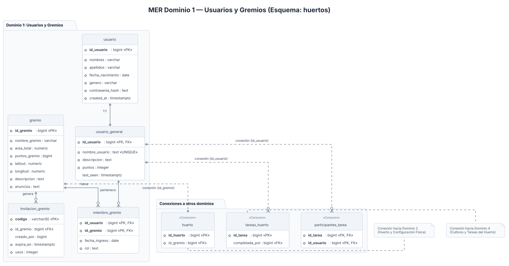

---

### 1.3. Dominio 2: Huerto y Configuración Física

Guarda la configuración física del huerto de cada gremio (`huerto`) junto con los catálogos de tipo de diseño, número de parcelas, cerca de seguridad, suelo, riego y abono.

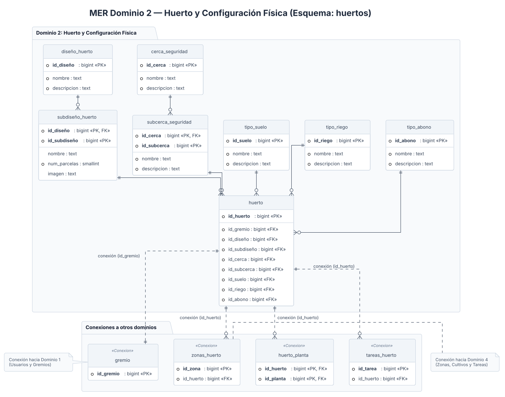

---

### 1.4. Dominio 3: Catálogo de Plantas Ecuatorianas

Guarda la información de las plantas del Ecuador (`planta`), su familia botánica, tipo de cultivo, provincias donde se cultiva y sus usos medicinales.

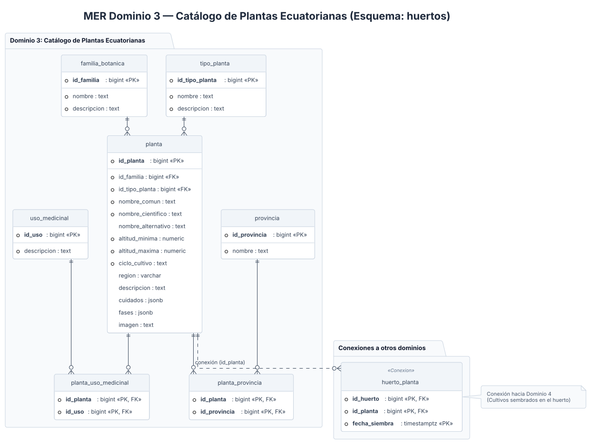

---

### 1.5. Dominio 4: Cultivos, Parcelas y Tareas del Huerto

Registra las secciones y parcelas del huerto (`zonas_huerto`), los ciclos de preparación (`ciclos_zona`), las plantas sembradas (`huerto_planta`), las tareas del huerto (`tareas_huerto`) y los participantes que reciben puntos (`participantes_tarea`).

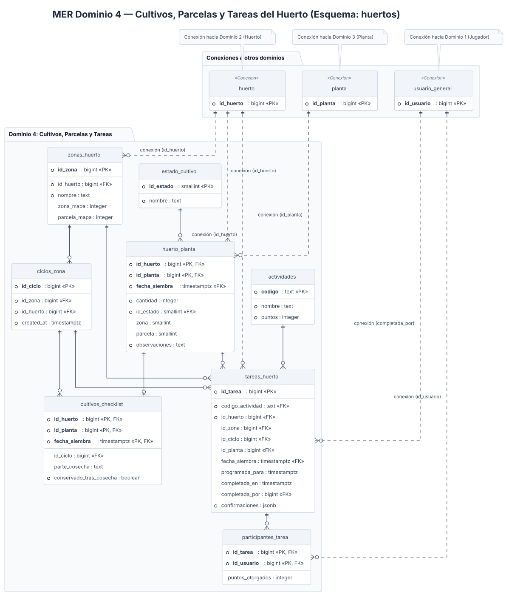

---

## 2. Diagramas de Secuencia

A continuación se muestran los diagramas de secuencia para las 10 historias de usuario implementadas:

### HU-001: Registro e Inicio de Sesión del Jugador

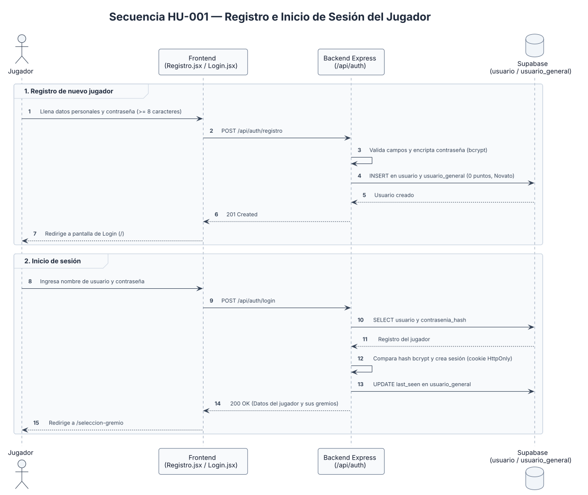

### HU-002: Creación y Ubicación Real del Gremio

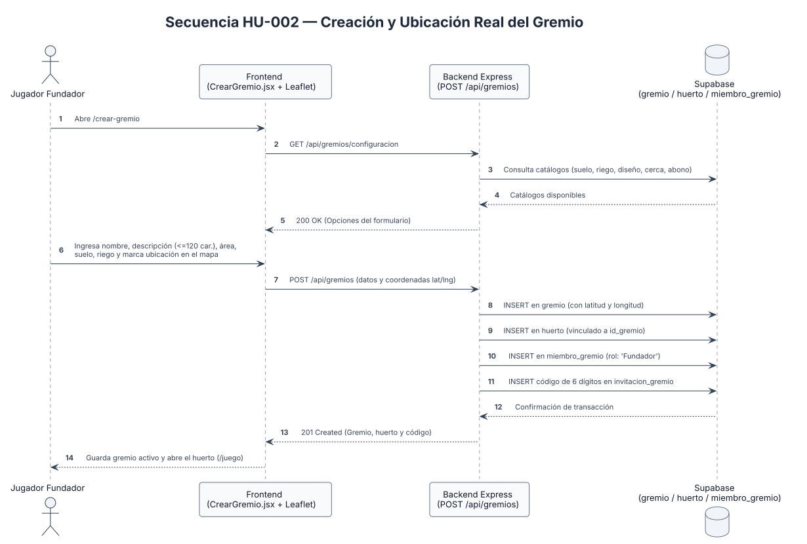

### HU-003: Unirse a un Gremio con Código o QR

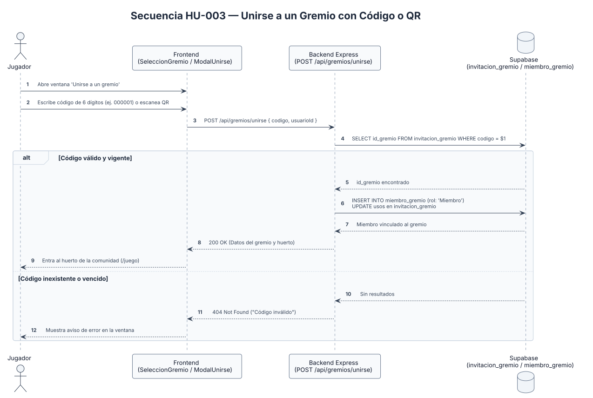

### HU-004: Consulta y Filtrado del Catálogo de Plantas

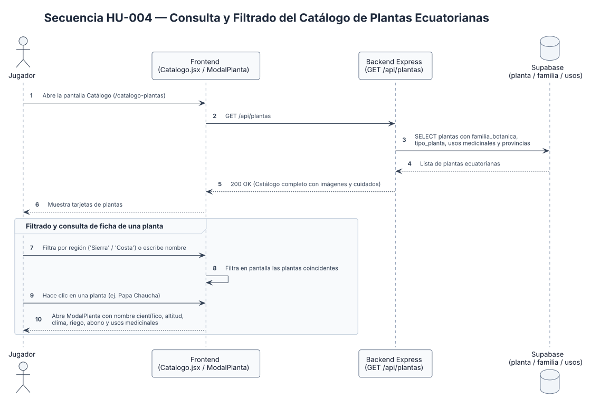

### HU-005: Siembra por Parcelas y Crecimiento en el Huerto

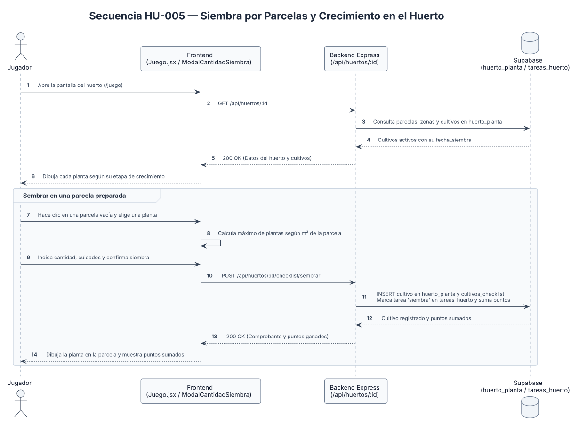

### HU-006: Consulta del Clima Actual y Fase Lunar

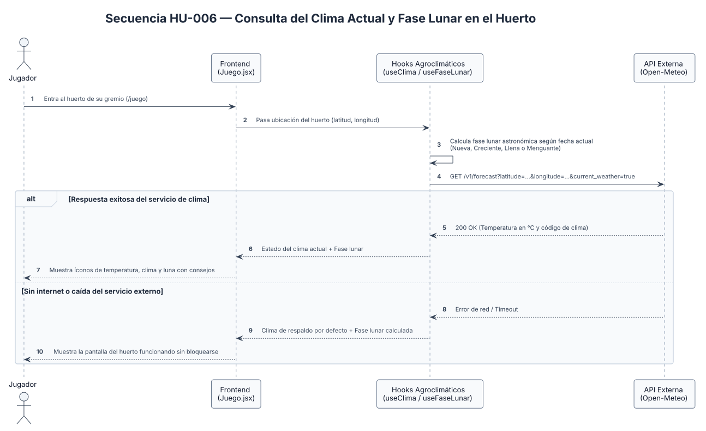

### HU-007: Completar Recordatorios, Cosechar y Subir de Rango

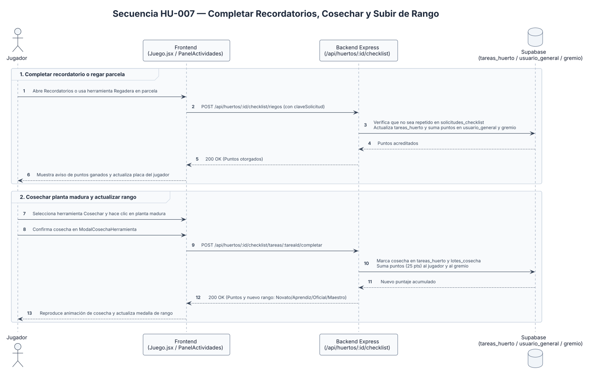

### HU-008: Ver Perfil del Jugador y Editar Habilidades

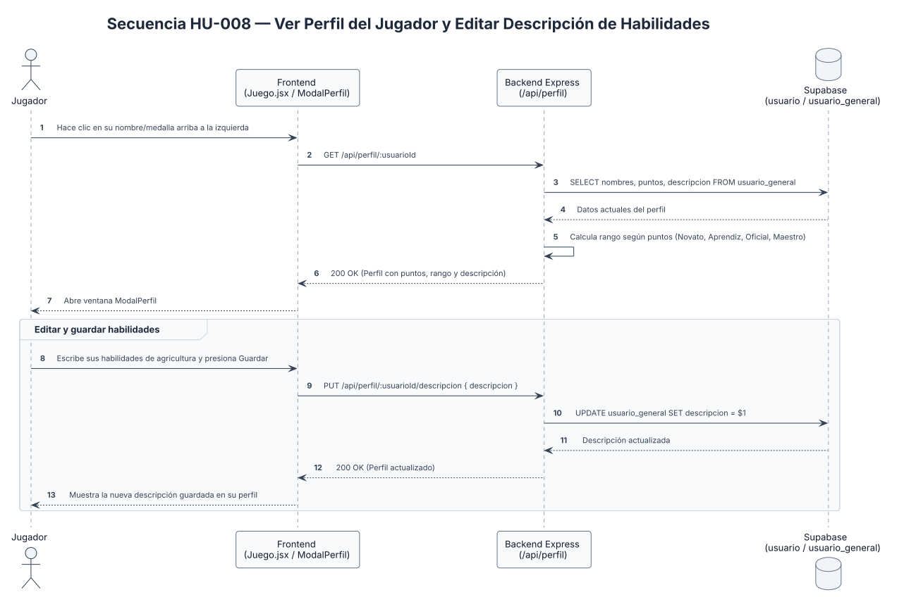

### HU-009: Ver Miembros en Línea y Consultar Ranking de Gremios

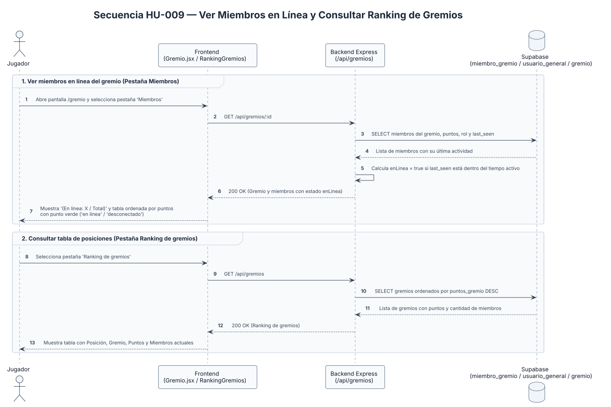

### HU-010: Edición de Descripción y Anuncios por Oficiales y Maestros

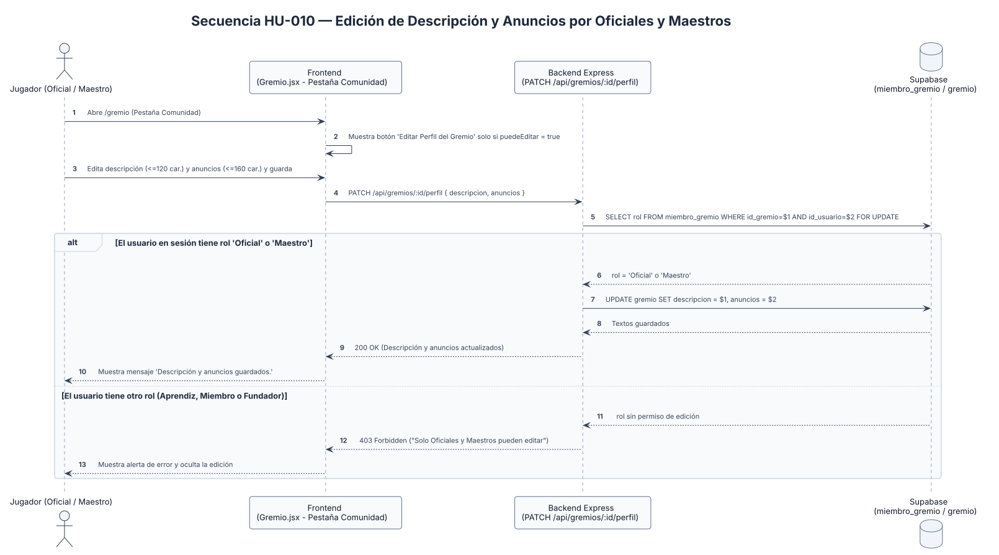

---

## 3. Rangos y Puntajes del Juego

### 3.1. Rangos del Jugador

| Rango | Puntos | Descripción |
| :--- | :---: | :--- |
| **Novato** | 0 - 50 | Rango inicial al registrarse en el sistema. |
| **Aprendiz** | 51 - 120 | Jugador que ya participa de forma activa en el cuidado del huerto. |
| **Oficial** | 121 - 250 | Puede editar la descripción y publicar anuncios en su gremio. |
| **Maestro** | Más de 250 | Rango máximo dentro del gremio; también puede editar la descripción y anuncios. |

### 3.2. Actividades y Puntos

| Actividad | Modalidad | Puntos |
| :--- | :---: | :---: |
| **Retiro de maleza** | Individual | 15 puntos |
| **Preparación de tierra** | Grupal | 30 puntos por inscrito |
| **Siembra** | Individual | 30 puntos |
| **Colocar señalética** | Individual | 25 puntos |
| **Riego de parcela** | Individual | 5 puntos |
| **Aplicación de abono** | Grupal | 20 puntos |
| **Limpieza del huerto** | Grupal | 30 puntos por inscrito |
| **Ritual de agradecimiento** | Grupal (opcional) | 20 puntos por inscrito |
| **Cosecha** | Individual | 35 puntos |
| **Secado y almacenamiento** | Individual o Grupal | 20 puntos |
